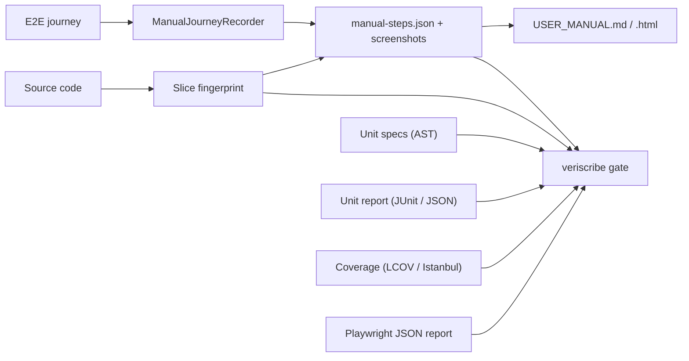
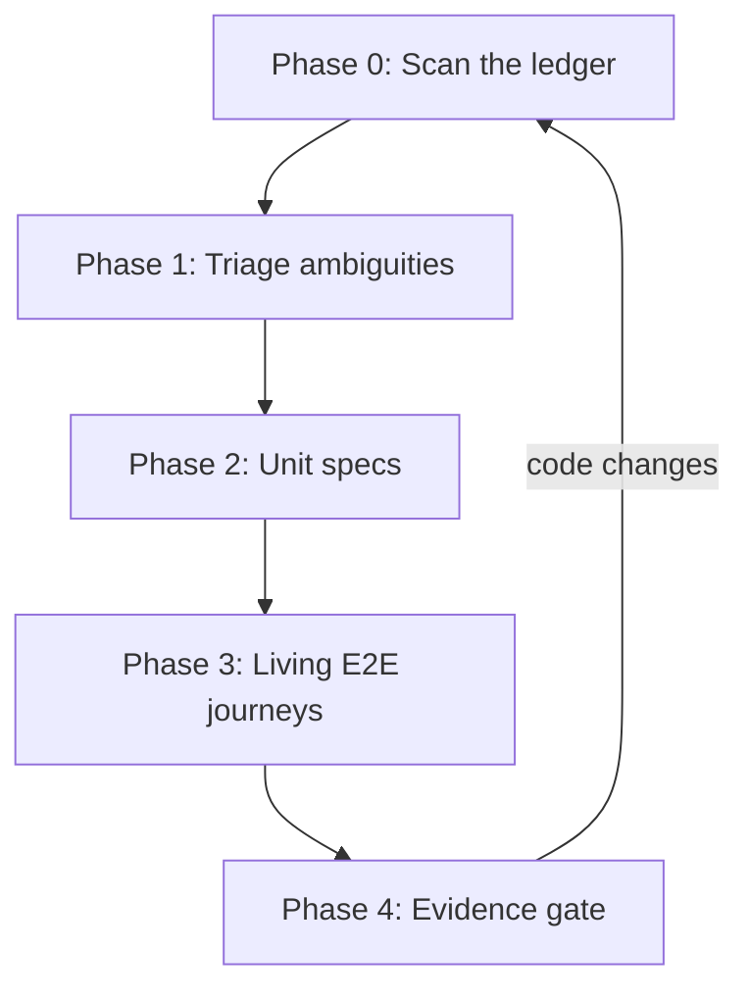

# The Frontend QA & Living Manual Bible

> **The canonical handbook for multi-dimension frontend testing, evidence-based quality gates and living user manuals with VeriScribe.**
>
> Applies to **VeriScribe 1.5.1** · Playwright 1.5x+ · TypeScript 4.9–6.x · Angular 17+ (written against Angular 22 zoneless + vitest).
> Every rule here was tested on a real codebase (`planta94/personal-website`). Where a rule exists because of a real bug, the bug is cited.

---

## How to use this document

| You are…                       | Read                                                                                                           |
| ------------------------------ | -------------------------------------------------------------------------------------------------------------- |
| New to the paradigm            | [Part I](#part-i-the-commandments) → [Part II](#part-ii-the-9-quality-dimensions)                              |
| Setting up a repository        | [Part III](#part-iii-toolchain-setup) → [Checklist A](#checklist-a-rolling-out-to-a-new-repository)            |
| Writing unit specs             | [Part IV §Phase 2](#phase-2-unit-specs-that-test-behaviour) + [Templates](#part-vi-templates)                  |
| Writing E2E journeys / manuals | [Part IV §Phase 3](#phase-3-living-e2e-journeys) + [Template T4](#t4-living-e2e-journey)                       |
| Fixing a red gate              | [Part IV §Phase 4](#phase-4-the-evidence-gate--maintenance) → [Appendix B](#appendix-b-troubleshooting-matrix) |
| Debugging something strange    | [Part V: Field Lessons](#part-v-field-lessons)                                                                 |
| An AI coding agent             | All of Part I is binding. Also follow `.agent/skills/veriscribe/SKILL.md` and the repository's `AGENTS.md`.    |

**Wording.** **MUST** / **MUST NOT** are hard rules: breaking one is a defect. **SHOULD** is the default, and you need a written reason to deviate. **MAY** is optional.

---

## Contents

- [Part I: The Commandments](#part-i-the-commandments)
- [Part II: The 9 Quality Dimensions](#part-ii-the-9-quality-dimensions)
- [Part III: Toolchain Setup](#part-iii-toolchain-setup)
- [Part IV: The Pipeline (Phases 0–4)](#part-iv-the-pipeline-phases-04)
- [Part V: Field Lessons](#part-v-field-lessons)
- [Part VI: Templates](#part-vi-templates)
- [Part VII: Checklists](#part-vii-checklists)
- [Appendix A: Command Reference](#appendix-a-command-reference)
- [Appendix B: Troubleshooting Matrix](#appendix-b-troubleshooting-matrix)
- [Appendix C: Glossary](#appendix-c-glossary)
- [Appendix D: This Repository's Profile](#appendix-d-this-repositorys-profile)

---

## The Living Specification Spine (why this exists)

Tests and user documentation usually live apart. Tests pass silently in CI, nobody outside engineering sees them, and the manual is out of date the day someone renames a button.

The **Living Specification Spine** joins them. Every user-facing route has one Playwright journey, and that journey does two things at once:

1. **Verifies**: it clicks through the real UI, asserts outcomes, and runs accessibility, layout, i18n and console checks on every step.
2. **Documents**: it captures annotated desktop and mobile screenshots and writes a manual chapter (`manual-steps.json` → Markdown + HTML).

The chapter is **bound to a fingerprint of the source code it was recorded against**. When that code changes, the chapter goes _stale_ and the CI gate fails until the journey is re-run. Re-running it re-verifies the behaviour and refreshes the manual in one go.



---

# Part I: The Commandments

These are binding on every human and AI contributor.

### 1. Never cement a bug into a test.

If the code looks wrong, ambiguous, or disagrees with the docs, product copy or another component, **stop**. Record it in `qa-system/qa-manifest.json` under `ambiguitiesOrSuspectedBugs` with `"resolution": "OPEN"` and ask the owner. A test that asserts broken behaviour is worse than no test, because it guards the bug.
_Real case:_ the CV page ignored `?lang=`, which the header link always sends. A test asserting "CV shows the remembered language" would have locked that bug in.

### 2. Test behaviour, not existence.

`expect(component).toBeTruthy()` and `expect(el.querySelector('.menu')).not.toBeNull()` prove almost nothing. Every `it()` / `test()` block **MUST** assert something a user or caller could observe: rendered text, exact element count (`toHaveLength(1)`), attributes, emitted values, HTTP requests, persisted state, or DOM structure. In **VeriScribe 1.5.1**, the AST spec analyser enforces this **per test**:

- **Existence-only matchers are always trivial:** `.toBeTruthy()`, `.toBeDefined()`, `.not.toBeNull()`, `.not.toBeUndefined()` and `.not.toBeFalsy()` are classified as `existence-only` on _any_ expression (not just component instances). Note: positive `.toBeNull()` (proving an element is _absent_) is still meaningful.
- **Every test must assert meaningfully:** any `it()` block with 0 meaningful assertions (even if the file as a whole has 30) is flagged as `empty-test` or `weak-test` and marks the entire spec `SHALLOW_STUB` (at most one `should create` / `is created` smoke test is excused when behavioral tests exist alongside it).
- **Self-comparisons and literal tautologies are rejected:** `expect(x).toBe(x)`, `expect(comp.title).toEqual(comp.title)` and `expect({}).toBeTruthy()` are flagged as `tautology`.
- **Unguarded `.subscribe()` assertions are rejected:** `expect(...)` inside `.subscribe()` is flagged as `unguarded-async` unless the test takes a `done` callback, wraps in `fakeAsync` / `waitForAsync`, calls `.flush()` / `.next()` / `firstValueFrom()` / `lastValueFrom()`, or uses `expect.assertions()`.

### 3. Tests use real data and contracts, not invented ones.

Fixtures **MUST** come from the real contract: the OpenAPI schema, the real i18n dictionaries, or the real route table. Type them against production interfaces so contract drift becomes a **compile error** (see [T1](#t1-typed-contract-fixtures)).

### 4. Every route has a journey, and every journey produces a manual chapter.

Each `featureSlices` entry has a Playwright spec at its `e2eSpecPath`, built on `ManualJourneyRecorder`, whose `chapterId` equals the slice's `manualChapterId` (`manual-<slice>`).

### 5. Evidence, not status flags.

Never hand-edit `status`, `specStatus`, fingerprints or `lastVerifiedCommit` to turn the gate green. Produce the evidence: pass the specs, re-record the journey, and resolve the ambiguity. The gate ignores flags anyway.

### 6. Tune checks; don't delete them.

If a check is noisy, silence it **at the narrowest scope** (step < recorder < config) and add a comment explaining why. Never disable a rule globally to hide real failures.
_Real case:_ the old suite disabled axe `color-contrast` everywhere. Turning it back on found **47** real WCAG failures, all fixed with three colour-token changes.

### 7. Navigate the way the router does.

Always use `manual.goto()` / `manual.assertCurrentRoute()`. They respect hash vs path routing and `baseHref`. Only use raw `page.goto()` in non-recorded tests, and then with the full hash URL.

### 8. Use contextual presets and real budgets.

Full app pages use `verifyAccessibility({ preset: 'full-page' })`. Documents and print previews use `'document-preview'`. Anything printable **MUST** assert a page budget with `verifyVisualLayout({ media: 'print', pageBudget })`.

### 9. Degraded states are first-class.

Every network dependency gets a failure test (4xx/5xx/offline). It **MUST** prove that the UI stays consistent: the label matches the content, nothing broken is persisted, and the user can recover. Every user-visible failure mode also gets a troubleshooting entry in the manual.

### 10. Keep the suite deterministic.

No live third-party calls, no wall-clock dependence, and no order coupling between tests. Mock at the network boundary (`page.route`, `HttpTestingController`) and drive time and animation frames explicitly.

---

# Part II: The 9 Quality Dimensions

Each dimension has a **unit-level** and an **E2E-level** verification. A slice is "done" only when every applicable dimension has evidence. Mark a dimension `false` honestly when it is untested or not applicable, and say why.

| #   | Dimension                            | Unit level                                                                                      | E2E level (VeriScribe)                                                                                          | Manifest flag (slice / component)                  |
| --- | ------------------------------------ | ----------------------------------------------------------------------------------------------- | --------------------------------------------------------------------------------------------------------------- | -------------------------------------------------- |
| 1   | Happy-path journey                   | Every `@if`/`@for` branch, inputs and outputs, signal state                                     | `recordStep()` per user task, with assertions inside `action`                                                   | `happyPathJourney` / `functionalAndEdgeCases`      |
| 2   | Error & degraded states              | `HttpTestingController.flush(…, {status})`, `.error()`, rejected promises, `try/finally` resets | `page.route()` → 4xx/5xx/offline; `recordTroubleshootingScenario()`                                             | `errorResilience4xx5xx` / `errorAndDegradedStates` |
| 3   | RBAC & auth                          | Role directives, guards, interceptors                                                           | Role matrix loop; guest redirect tests                                                                          | `rbacAccessMatrix` / `rbac`                        |
| 4   | Responsive geometry                  | Rarely (logic only)                                                                             | `verifyResponsiveViewports()` + `captureResponsiveViewports`                                                    | `responsiveViewports`                              |
| 5   | Contract sync                        | Fixtures typed against interfaces/OpenAPI; key-parity tests                                     | Mocks validated against `openapi.json` (`veriscribe openapi-slice`)                                             | `openApiContractSync`                              |
| 6   | Accessibility (WCAG 2.1 AA)          | ARIA attributes, keyboard handlers (Enter **and** Space), labels                                | `verifyAccessibility({ preset })` (axe-core)                                                                    | `axeAccessibility` / `a11y`                        |
| 7   | i18n & localisation                  | Render in **every** locale; no hard-coded strings; dictionary parity                            | `assertNoUntranslatedI18nKeys()` (auto per step), locale switch steps, locale matrix                            | `i18nLocales` / `i18n`                             |
| 8   | Performance & memory                 | rAF cancelled, listeners removed, `takeUntilDestroyed`, WebGL disposed                          | Web-vitals budgets (if measured)                                                                                | `performanceWebVitals` / `memoryLeakUnsubscribe`   |
| 9   | Living documentation & visual health | n/a                                                                                             | Per-step layout checks (overflow, broken/stretched images, zero-size SVG, occlusion), screenshots, `finalize()` | (manual evidence = fresh)                          |

### Dimension notes that are easy to get wrong

- **D2:** A degraded state is only tested once you assert _what stays the same_. That means the previous language, the previous data, nothing persisted, and the button re-enabled. "It didn't crash" is not an assertion.
- **D3:** With no authentication (a public site), set `allowedRoles: ['user']` and `projectConfig.roles: ['user']`. Don't invent `admin`/`guest` journeys for roles that don't exist.
- **D5:** Without an HTTP API, the contract is your static data (for example i18n JSON). Enforce it with typed fixtures plus key-parity tests. Leave `openApiContractSync: false` and write down why.
- **D6:** `role="button"` on a non-button **MUST** handle Enter _and_ Space and expose state (`aria-expanded`/`aria-pressed`). Prefer a real `<button type="button">`.
- **D7:** "Translated" means _every locale renders its own text_. A `lang === 'zh' ? '中文' : 'English'` ternary silently shows Chinese or English to every other locale (real bug B1: Malay users saw Chinese).
- **D8:** Animation loops and canvas contexts **MUST** be torn down on destroy. Prove it by spying on `cancelAnimationFrame` and `removeEventListener` with the exact handler references (see [T3](#t3-animation--resource-cleanup-spec)).

---

# Part III: Toolchain Setup

### 1. Install

```bash
npm install -D veriscribe@^1.5.1 @playwright/test typescript@6 @axe-core/playwright @vitest/coverage-v8
npx playwright install chromium            # Linux/CI: --with-deps chromium
```

- **TypeScript 7** (the native Go port) has no JS compiler API. If the app needs TS 7, also install `typescript6@npm:typescript@6`; VeriScribe looks for it.
- **Vitest coverage** (`ng test --coverage`) requires `@vitest/coverage-v8` (or `@vitest/coverage-istanbul`) matching your `vitest` major version.
- Re-run `playwright install` after every `@playwright/test` upgrade.

### 2. Initialise & diagnose

```bash
npx veriscribe init --dry-run   # preview
npx veriscribe init             # skill, schema, config, qa:* scripts, build guard, first scan
npx veriscribe doctor           # must report 0 problems
```

`init` never overwrites `qa:*` scripts you have customised. Re-running it after an upgrade refreshes `.agent/skills/veriscribe/SKILL.md` and the schema.

### 3. `veriscribe.config.ts`

```typescript
import { defineConfig } from 'veriscribe/config';

export default defineConfig({
  router: { mode: 'hash', baseHref: '/' }, // 'hash' for withHashLocation(); 'path' otherwise
  i18n: {
    locales: ['en-US'], // manual locales; >1 requires switchLocale
    defaultLocale: 'en-US',
    // switchLocale: async (page, locale) => { ... }   // needed for a locale matrix
  },
  artifactsRootDir: 'docs/manual-artifacts',
  manualsOutputDir: 'docs/manuals',
  checks: {
    i18nKeys: { keySources: ['public/i18n'] }, // where your dictionaries live
    visualLayout: { ignoreSelectors: ['#particleCanvas'] }, // decorative full-bleed layers only
    // consoleErrors: { allow: [/ResizeObserver loop/] },
  },
  gate: {
    playwrightReport: 'qa-system/reports/playwright-results.json',
    unitReport: 'qa-system/reports/unit-results.xml',
    coverage: {
      file: 'coverage/personal-website/lcov.info',
      branches: 70,
      lines: 80,
    },
    allowList: [], // [{ item: 'component:x', reason: '…' }]
  },
});
```

The CLI reads **literal** values without executing the file. Functions (`switchLocale`) only run inside Playwright.

### 4. `angular.json` unit test & coverage evidence (v1.5)

Configure `@angular/build:unit-test` so plain `npx ng test --watch=false` emits both the JUnit XML test report and the LCOV / JSON coverage reports consumed by `veriscribe gate`:

```json
"test": {
  "builder": "@angular/build:unit-test",
  "options": {
    "coverage": true,
    "coverageReporters": ["text", "lcov", "json"],
    "reporters": [
      "default",
      ["junit", { "outputFile": "qa-system/reports/unit-results.xml" }]
    ]
  }
}
```

### 5. `playwright.config.ts`

```typescript
import { defineConfig, devices } from '@playwright/test';

export default defineConfig({
  testDir: './e2e', // journeys live in e2e/journeys/<slice>.e2e.spec.ts
  fullyParallel: false, // journeys write shared artifacts; keep sequential
  workers: 1,
  retries: process.env['CI'] ? 1 : 0,
  reporter: [
    ['list'],
    ['html', { open: 'never' }],
    // Gate evidence. Keep it OUTSIDE playwright-report/: the html reporter wipes that folder.
    ['json', { outputFile: 'qa-system/reports/playwright-results.json' }],
  ],
  use: { baseURL: 'http://localhost:4200', trace: 'retain-on-failure' },
  projects: [
    {
      name: 'chromium',
      use: { ...devices['Desktop Chrome'], viewport: { width: 1440, height: 900 } },
    },
  ],
  webServer: {
    command: 'npm start',
    url: 'http://localhost:4200',
    reuseExistingServer: !process.env['CI'],
    timeout: 120_000,
  },
});
```

> [!WARNING]
> `npx playwright test --reporter=list` **replaces** every configured reporter, including the JSON evidence. Use it only for local debugging. Run plain `npx playwright test` before you gate.

### 6. Build output guard

If manuals are published inside the app's build output (for example GitHub Pages `docs/`), `ng build` would delete them. `init` adds `deleteOutputPath: false` **only** to build targets whose output contains `manualsOutputDir`. To check or repair: `npx veriscribe doctor` / `doctor --fix`. Do not apply a blanket `deleteOutputPath: false` to every target; that was the v1.3 approach.

### 7. What to commit

| Commit                                                   | Don't commit                                       |
| -------------------------------------------------------- | -------------------------------------------------- |
| `qa-system/qa-manifest.json`, `qa-system/schemas/`       | `test-results/`, `playwright-report/`, `coverage/` |
| `docs/manual-artifacts/**` (the evidence)                | Scratch probes and one-off scripts                 |
| `docs/manuals/**` (if published)                         |                                                    |
| `veriscribe.config.ts`, `playwright.config.ts`, `e2e/**` |                                                    |

---

# Part IV: The Pipeline (Phases 0–4)



## Phase 0: Scan the ledger

```bash
npx veriscribe scan
```

Outputs `qa-system/qa-manifest.json` (the **Master Coverage Ledger**) and `qa-system/reports/coverage-audit.md`. The scanner uses the TypeScript AST, not regexes.

**Ledger anatomy**

| Section               | Contains                                                                                                                  | You may edit                                                                                         |
| --------------------- | ------------------------------------------------------------------------------------------------------------------------- | ---------------------------------------------------------------------------------------------------- |
| `projectConfig`       | router mode, locales, roles, viewports                                                                                    | `roles`, `viewports`, `openApiSchemaPath`                                                            |
| `components.<key>`    | file/template/spec paths, `specStatus`, `specMetrics`, detected features, `ambiguitiesOrSuspectedBugs`, `lastContentHash` | `ambiguitiesOrSuspectedBugs`, `dimensionsVerified`                                                   |
| `services.<key>`      | same, plus HTTP endpoints and dependents                                                                                  | `ambiguitiesOrSuspectedBugs`, `dimensionsVerified`                                                   |
| `featureSlices.<key>` | `routePath`, `components`, `services`, `mockFixtures`, `e2eSpecPath`, `manualChapterId`, `status`                         | `allowedRoles`, `mockFixtures`, extra `services`, `paramOverrides`, `manualChapterId`, `e2eSpecPath` |

**Never edit:** `status`, `specStatus`, `specMetrics`, `lastContentHash`, `baseline`, `lastVerifiedCommit`, or `routePath` (rescans match slices by `routePath`, so editing it creates a duplicate).

**What a slice fingerprint covers**

The fingerprint is a content hash of the slice's component `.ts` and template files, its service files, its `mockFixtures`, and its `e2eSpecPath`. **It does not cover stylesheets, i18n JSON or assets** unless you list them in `mockFixtures`.

> [!TIP]
> Add your locale dictionaries (e.g. `public/i18n/en.json`) to each slice's `mockFixtures`. Then a copy change makes the manual stale, and the screenshots get re-recorded with the new wording.

## Phase 1: Triage ambiguities

Before writing any spec, read each component's template and logic, and each service's HTTP and error paths. Look for:

- hard-coded user-facing strings, or locale ternaries (`=== 'zh' ?`);
- state committed _before_ an async operation succeeds;
- plain class fields mutated after `await` in a **zoneless** app (the view won't update);
- links or params one component sends that the receiver ignores (e.g. `?lang=`);
- `role="button"` without Space handling or ARIA state;
- duplicated data that can drift (fallback dictionaries, copied lists in two components);
- `.subscribe()` without `takeUntilDestroyed`, and rAF or listeners without cleanup;
- `track` expressions keyed on translated text;
- the same rule implemented differently in two places (e.g. author highlighting in Publications vs CV).

**Recording protocol**

```json
"ambiguitiesOrSuspectedBugs": [
  {
    "id": "VS-B3-translation",
    "description": "setLanguage() sets currentLang and persists before the dictionary loads; a failed load shows 中文 over English and remembers zh. Expected: commit only on success?",
    "resolution": "OPEN"
  }
]
```

| `resolution`           | Meaning                                                                                                                                     | Gate     |
| ---------------------- | ------------------------------------------------------------------------------------------------------------------------------------------- | -------- |
| `OPEN`                 | Waiting for an owner's decision. Write **no** test that locks either behaviour.                                                             | ❌ fails |
| `CONFIRMED_BUG`        | Owner confirmed it is a bug. Fix it, test the _correct_ behaviour, and prefix the description with `FIXED <date>:` plus the covering tests. | ✅       |
| `INTENTIONAL_BEHAVIOR` | Owner confirmed it is by design. Test it as-is and record the reason.                                                                       | ✅       |

Ask the owner in batches, recommend a fix for each item, and list the decisions in the PR.

## Phase 2: Unit specs that test behaviour

### Standards

1. **Render the real template.** Import the standalone component; don't shallow-mock children unless they do I/O.
2. **Cover every branch.** Each `@if`/`@else`/`@for`/`@empty`/`@switch` needs at least one assertion on each side.
3. **Cover every locale** that the component renders text for (`describe.each(['en','zh','ms'])`), and assert the text comes from _that_ locale's dictionary.
4. **Services:** use `HttpTestingController`. Assert method, URL and payload; flush success **and** 4xx/5xx/network errors; call `http.verify()` in `afterEach`.
5. **Inputs, outputs and models:** set inputs via `fixture.componentRef.setInput()` and spy on outputs.
6. **Keyboard & ARIA:** dispatch `keydown` Enter **and** Space; assert `aria-*` state changes.
7. **Lifecycle:** `fixture.destroy()`, then assert subscriptions, listeners, rAF and observers are cleaned up.
8. **Routing:** use `RouterTestingHarness` for routes and query params. Test the route table itself (paths, redirects, wildcard).
9. **No trivial assertions (1.5.1 per-test AST enforcement).** Every `it()` / `test()` block **MUST** contain ≥1 meaningful assertion (or delegate to a helper function in the same file that asserts). The AST analyser rejects `.toBeTruthy()`, `.toBeDefined()`, `.not.toBeNull()`, `.not.toBeUndefined()` and `.not.toBeFalsy()` as `existence-only` on _any_ expression; self-comparisons (`expect(x).toBe(x)`) and constant literals as `tautology`; and unguarded `expect(...)` inside `.subscribe()` callbacks as `unguarded-async`. Scaffold output (`// @veriscribe-scaffold`) **MUST** be completed and the marker deleted.
10. **Per-file branch & line coverage (1.5.1 coverage gate).** Every in-scope component and service source file **MUST** meet ≥70% branch coverage and ≥80% line/statement coverage. Mock external boundaries (`vi.mock('html2canvas')`, `vi.mock('jspdf')`, `HttpTestingController`) rather than stubbing out the component's own methods.
11. **Naming:** `it('<observable outcome> when <condition>')`. A test name is a requirement.

### Angular zoneless rules (Angular 18+ without zone.js)

| Situation                                                                            | Do this                                                                                                                                                           |
| ------------------------------------------------------------------------------------ | ----------------------------------------------------------------------------------------------------------------------------------------------------------------- |
| Initial render                                                                       | `fixture.detectChanges(); await fixture.whenStable();` (wrap it in a `render()` helper)                                                                           |
| State changes after async work, and you want to prove the _app_ re-renders by itself | `fixture.autoDetectChanges()`, then trigger the action. Let the promise chain settle (`await new Promise(r => setTimeout(r))`), then `await fixture.whenStable()` |
| Component state mutated after `await`                                                | It **MUST** be a `signal` (or call `markForCheck`). A plain field won't re-render (real bug B2)                                                                   |
| `requestAnimationFrame` loops                                                        | Spy on rAF to _record_ callbacks, and drive frames explicitly. Angular's scheduler also uses rAF, so filter to the component's own callback                       |
| `<canvas>` in jsdom                                                                  | `getContext` returns `null`. Stub it with a recording fake (to test drawing) or return `null` (to test the guard)                                                 |
| TS 6 strict mode                                                                     | Type the spec callbacks explicitly; there is no implicit `any` in specs either                                                                                    |

### Anti-patterns (rejected in review and by the 1.5.1 AST analyser)

```typescript
// ❌ Existence only — rejected on ANY expression (including DOM queries and attributes)
it('should create', () => expect(component).toBeTruthy());
expect(el.querySelector('.lang-dropdown-menu')).not.toBeNull(); // use querySelectorAll(...).toHaveLength(1)
expect(avatar.getAttribute('alt')).toBeTruthy(); // assert the exact alt text: .toBe('Profile')

// ❌ Self-comparison / constant tautology
expect(component.title).toBe(component.title);
expect({}).toBeTruthy();

// ❌ Unguarded assertion inside .subscribe() (silently passes if observable never emits)
service.data$.subscribe((v) => expect(v).toBe('ok')); // use firstValueFrom(), .flush(), fakeAsync, or done

// ❌ Re-implements the code under test
expect(component.label()).toBe(component.lang() === 'zh' ? '中文' : 'English');

// ❌ Asserts a bug (Commandment 1)
it('keeps the button disabled after download', …);

// ❌ Invented fixture that can drift from the real contract
const dict = { header: { about: 'About' } } as any;

// ❌ Forces change detection manually, which hides zoneless re-render bugs
component.isGenerating = false; fixture.detectChanges(); expect(btn.disabled).toBe(false);
```

## Phase 3: Living E2E journeys

### Anatomy of a journey file

```
e2e/journeys/<slice>.e2e.spec.ts
└─ test.describe('Feature Slice: <Name> (<route>)')
   ├─ test('[<locale>][Role: <role>] … + manual capture')   ← the recorded journey (one per role × locale)
   │    1. new ManualJourneyRecorder({ chapterId: 'manual-<slice>', … })
   │    2. manual.goto() + assertCurrentRoute()
   │    3. verifyAccessibility({ preset })
   │    4. verifyVisualLayout({ media: 'print', pageBudget })   (printables)
   │    5. verifyResponsiveViewports()
   │    6. recordStep() × N   (assertions inside `action`)
   │    7. assertNoUntranslatedI18nKeys() + assertVisualLayoutHealth()
   │    8. recordTroubleshootingScenario() × N
   │    9. finalize()
   ├─ test('[Degraded] …')      ← no recorder; asserts failure behaviour
   ├─ test('[<locale>] …')      ← locale-specific regressions
   ├─ test('[Mobile] …')        ← viewport-specific behaviour
   └─ test('[Deep link] …')     ← fresh-load URL contracts
```

**Why degraded tests don't use the recorder:** `finalize()` fails on _any_ console error. Error paths log errors by design. Either put them in recorder-free tests, or add a recorder-level `checks.consoleErrors.allow` that matches _only_ the expected message.

### Recorder API (v1.5)

| Call                                                                                                                                                | Purpose                                                                                                                           |
| --------------------------------------------------------------------------------------------------------------------------------------------------- | --------------------------------------------------------------------------------------------------------------------------------- |
| `new ManualJourneyRecorder(page, { chapterId, featureTitle, summary, role, locale, routePath, preconditions, captureResponsiveViewports, checks })` | Start a chapter                                                                                                                   |
| `manual.goto(route, opts?)`                                                                                                                         | Router-aware navigation (hash/path/baseHref)                                                                                      |
| `manual.assertCurrentRoute(route)`                                                                                                                  | Assert the router actually landed there                                                                                           |
| `manual.recordStep({ title, userInstruction, expectedOutcome, target, notes?, action?, checks? })`                                                  | Wait for `target`, scroll it into view, run `action`, run per-step checks, and capture an annotated desktop (+ mobile) screenshot |
| `manual.recordTroubleshootingScenario({ scenario, userMessage, resolution, target? })`                                                              | Add a troubleshooting row, with a screenshot if `target` is set                                                                   |
| `manual.verifyAccessibility({ preset, disableRules?, contextSelector? })`                                                                           | axe-core audit. Presets: `full-page`, `document-preview`, `modal`, `dialog`, `embedded-canvas`                                    |
| `manual.verifyVisualLayout({ media: 'print', pageBudget: { pageSize: 'A4', maxPages } })`                                                           | Print emulation + page count (real PDF in Chromium, estimate elsewhere). Returns `{ pages, method }`                              |
| `manual.verifyResponsiveViewports()`                                                                                                                | Layout health at desktop/tablet/mobile                                                                                            |
| `manual.assertNoUntranslatedI18nKeys()`                                                                                                             | No raw `a.b.c` keys visible                                                                                                       |
| `manual.assertVisualLayoutHealth(label)`                                                                                                            | Overflow, broken or stretched images, zero-size SVG, occlusion                                                                    |
| `manual.finalize()`                                                                                                                                 | Fail on console/page errors, bind the fingerprint, write `manual-steps.json`                                                      |

Locale matrix: `forEachLocale(locale => test(…))` or `runLocaleMatrix(page, opts, async manual => …)`. Both need `i18n.switchLocale` when more than one locale is configured.

### Writing steps that are both tests and documentation

- **`title`:** imperative, task-oriented ("Download the CV as a PDF"), not "Inspect X".
- **`userInstruction`:** what the _user_ does, with UI labels in **bold** exactly as shown on screen.
- **`expectedOutcome`:** what the user _sees_. It **MUST** match what `action` asserts. If the manual promises it, the test checks it.
- **`action`:** performs the interaction **and** asserts the outcome with web-first assertions (`toHaveText`, `toHaveAttribute`, `toBeInViewport`, `toBeEnabled`). An `action` that only checks `toBeVisible()` is a screenshot, not a test.
- **`target`:** the smallest element that shows the result. Section-sized targets make vague screenshots.
- Return to the canonical state (e.g. switch back to English) inside the step that changed it, so later screenshots stay consistent.
- Write for the reader: no internal jargon ("Skia", "4x canvas"), no marketing language.

### Assertion rules for E2E

| Prove                         | Assertion                                                                                                 |
| ----------------------------- | --------------------------------------------------------------------------------------------------------- |
| Content                       | `toHaveText([...])` with the exact list, not `toContainText` on a container                               |
| Navigation                    | `toHaveURL(/#\/cv\?lang=en$/)` plus content on the new page                                               |
| Anchor scroll lands correctly | `toBeInViewport()` **and** the title's top is ≥ the fixed header's bottom (`expect.poll`)                 |
| Busy states                   | Visible busy label + disabled, **then** reset label + enabled after completion                            |
| Downloads                     | `page.waitForEvent('download')` → `suggestedFilename()`                                                   |
| New tabs                      | `Promise.all([context.waitForEvent('page'), link.click()])`                                               |
| Persistence                   | `page.evaluate(() => localStorage.getItem(…))`                                                            |
| Locale leaks                  | `body.innerText()` has no characters outside the expected script (e.g. no CJK in Malay)                   |
| Deep links                    | A **fresh load** (`page.goto` on a new page or `reload()`). Changing only the hash doesn't reload the app |

### Check-tuning ladder (narrowest first)

1. **Step:** `recordStep({ …, checks: { visualLayout: { ignoreSelectors: ['header'] } } })`, for one known situation (e.g. content scrolled under a sticky header after an anchor jump).
2. **Recorder:** `new ManualJourneyRecorder(page, { …, checks: { consoleErrors: { allow: [/expected message/] } } })`.
3. **Config:** `checks` in `veriscribe.config.ts`, only for project-wide decorative layers (e.g. a background particle canvas).
4. **Gate waiver:** `gate.allowList: [{ item, reason }]`. This is a last resort, always with a written reason and a removal date.

Selector and allow lists are **unioned** across layers. Rule objects are merged. `false` disables the check.

## Phase 4: The evidence gate & maintenance

```bash
npx ng test --watch=false                   # writes JUnit XML + LCOV / Istanbul coverage
npx playwright test                         # writes the Playwright JSON evidence
npx veriscribe scan                         # refresh the ledger
npx veriscribe manual                       # compile the manuals
npx veriscribe gate                         # reads gate.{playwrightReport,unitReport,coverage} from config
```

**For every in-scope item the 1.5.1 gate requires (all 6 evidence pillars):**

1. **Spec quality (AST):** the spec exists, is `TRIAGED` (`≥ minMeaningfulAssertions` total, every behavioral `it()` block has `≥ 1` meaningful assertion with `0` `weakTests`, no `tautology` or `unguarded-async`, and no scaffold marker).
2. **Unit test execution (`gate.unitReport` / `--unit-report`):** the spec executed (`passed + failed > 0`) and had `0` failing tests in the JUnit XML or Jest/Vitest JSON report.
3. **Branch & line coverage (`gate.coverage` / `--coverage`):** the component or service `.ts` source file meets minimum branch coverage (default `70%`) and line/statement coverage (default `80%`) in `lcov.info` or `coverage-final.json`.
4. **Fresh manual:** _every_ `manual-steps.json` for the slice (every role and locale) has a `sourceFingerprint` equal to the current one.
5. **Passing E2E (`gate.playwrightReport` / `--playwright-report`):** the slice's `e2eSpecPath` passed in the Playwright JSON report.
6. **No `OPEN` ambiguities.**

| Evidence state | Cause                                                                                                                | Fix                                   |
| -------------- | -------------------------------------------------------------------------------------------------------------------- | ------------------------------------- |
| `missing`      | No chapter matches `manualChapterId` / slice key                                                                     | Fix `chapterId`, then run the journey |
| `unbound`      | Chapter recorded before v1.4 or without a manifest                                                                   | `scan`, then re-run the journey       |
| `stale`        | Any fingerprinted file changed after recording (including the journey file itself, or even a BOM/line-ending change) | Re-run the journey                    |
| `fresh`        | ✅                                                                                                                   | —                                     |

**Exit codes:** 0 = pass, non-zero = fail. Check `$LASTEXITCODE` / `$?` **directly**. In PowerShell, piping (`| Select-Object`) makes the pipeline exit 0 even when the command failed.

**Incremental mode (pull requests):** `gate --base=origin/main --changed-only`. Read `qa-system/reports/impact-plan.md` to see exactly which specs, journeys and chapters the diff touched. On main, after a green gate, run `gate --update-baseline`. Never hand-edit `lastVerifiedCommit`.

---

# Part V: Field Lessons

Each lesson is **Problem → Rule → How to verify**.

### Routing & navigation

**L1: Hash-routed SPAs on static hosting.**
`page.goto('/cv')` hits the static server root and the hash router bounces to `/`.
**Rule:** set `router: { mode: 'hash' }` and use `manual.goto('/cv')`. In raw tests use `page.goto('/#/cv')`.

**L2: Hash-only navigation doesn't reload the app.**
`page.goto('/#/cv?lang=fr')` from `/#/cv?lang=en` changes only the hash, so bootstrap code (like reading a stored preference) doesn't re-run.
**Rule:** deep-link tests use a fresh page or `page.reload()`. Seed `localStorage` with `addInitScript`, and guard it with a `sessionStorage` flag if it must apply only once across reloads.

**L3: Cross-component URL contracts.**
The header opened `/cv?lang=<current>`, but the CV ignored `lang` (bug B4).
**Rule:** whenever one component _produces_ a URL parameter, a test **MUST** prove the receiver _consumes_ it. Cover supported values, unsupported values (`fr`, `''`, wrong case) and "same as current" (no refetch).

### Change detection & state

**L4: Zoneless apps don't re-render plain fields after `await`.**
With no zone.js, `this.isGenerating = false` after an async PDF render never reached the view. The button stayed "Generating PDF..." forever (bug B2).
**Rule:** any state changed after an async boundary **MUST** be a `signal`. Reset busy flags in `finally`.
**Verify:** a unit test with `autoDetectChanges()` and _no_ manual `detectChanges`, plus an E2E test that the label and enabled state reset after the download.

**L5: Commit state only after the async operation succeeds.**
`setLanguage()` updated the label and persisted the preference before the dictionary loaded. A 500 left "中文" over English text and remembered `zh` (bug B3).
**Rule:** optimistic UI needs rollback. Otherwise commit on success only.
**Verify:** route the request to 500; assert the label, content and storage are all unchanged; unroute and assert the retry works.

**L6: Duplicated data drifts.**
The in-memory English fallback had drifted from `en.json` (missing text and a missing tech tag).
**Rule:** a spec **MUST** assert that the copy deep-equals the source of truth, or the duplicate must be removed.

**L7: `track` by translated text rebuilds the DOM.**
`@for (b of bullets; track b)` destroys and recreates every node on a language switch (dev warning NG0956).
**Rule:** for lists whose items are translated strings, track by a stable id or `$index`.

### i18n

**L8: Locale ternaries leak the wrong language.**
`lang === 'zh' ? '主要成果' : 'Key Accomplishments'` showed Chinese to Malay users (bug B1).
**Rule:** every user-visible string goes through the dictionary. Grep for `=== 'zh'`, `=== 'en'` and `currentLang() ===` in templates before signing off.
**Verify:** an E2E test per non-default locale asserting no text in a foreign script (`/[\u3400-\u9fff]/` for Malay/English).

**L9: Dictionary parity is a contract.**
**Rule:** type fixtures from the real JSON files as the production interface ([T1](#t1-typed-contract-fixtures)). Assert identical key paths, equal list lengths and no empty strings across locales. In repositories with an `AGENTS.md` i18n rule, also update the interface and the fallback in the same change.

### Accessibility

**L10: Never disable `color-contrast` globally.**
It hid 47 failures, mostly design-token greys and blues on light tints.
**Rule:** fix the tokens (e.g. `#80868b → #5f6368`, `#1a73e8 → #1967d2`, `#34a853 → #188038` on white or tints). Only the `document-preview` preset (print documents) disables it. If a document must match an external artefact (a PDF generator), pin the original tokens in that component's `:host` and say so in a comment.

**L11: Custom interactive elements.**
**Rule:** prefer `<button type="button">`. If `role="button"` is unavoidable, it needs `tabindex="0"`, Enter **and** Space (with `preventDefault` so Space doesn't scroll), and `aria-expanded`/`aria-pressed`. Icon-only controls need an `aria-label`.

**L12: Redundant alt and label-in-name.**
An avatar next to the visible name uses `alt=""`. An `aria-label` must _contain_ the visible text (WCAG 2.5.3), or be omitted so the inner text is used.

**L13: Print documents lack landmarks by design.**
Use `preset: 'document-preview'` (it disables landmark-one-main, region, page-has-heading-one and color-contrast) instead of hand-picked `disableRules`.

### Visual layout & screenshots

**L14: The desktop viewport must be realistic.**
`Desktop Chrome` defaults to 1280×720, which compresses floating navbars (logos wrap into towers).
**Rule:** use `1440×900` (or `1536×864`). Brand marks get `flex-shrink: 0; white-space: nowrap`. Add an intermediate breakpoint (~1200px) before collapsing to mobile. Review the screenshots: a wrapped header label is a layout bug even when no check fails.

**L15: Sticky headers vs the occlusion check.**
After an anchor jump or when scrolling a lower card into view (e.g. expanding the 2nd timeline card in Experience), interactive controls above the target sit under the fixed header, and the occlusion check flags them.
**Rule:** ignore `header` _for that step only_ (`checks: { visualLayout: { ignoreSelectors: ['header'] } }`), **and** assert that the destination title or target lands below the header bottom (that's the real UX requirement).

**L16: Decorative full-bleed layers.**
Background canvases intercept `elementFromPoint`. Add them to config-level `visualLayout.ignoreSelectors`, and only those.

**L17: Print page budgets use a real PDF.**
In Chromium, `verifyVisualLayout({ media: 'print', pageBudget })` counts pages in a generated PDF. When the rule says "exactly N pages", also assert `result.pages === N`, because the budget only enforces `≤`.

**L18: Viewport flipping.**
The recorder restores viewport and media after every capture (even on failure). In hand-written tests, save `page.viewportSize()` and restore it in `finally`.

### Browser APIs & third parties

**L19: Geolocation in headless CI.**
Inject coordinates before load:

```typescript
await page.addInitScript(() => {
  navigator.geolocation.getCurrentPosition = (ok) =>
    ok({
      coords: {
        latitude: 3.140853,
        longitude: 101.693207,
        accuracy: 10,
        altitude: null,
        altitudeAccuracy: null,
        heading: null,
        speed: null,
      },
      timestamp: Date.now(),
    } as GeolocationPosition);
});
```

**L20: Third-party SDKs (maps, payments, analytics).**
`page.route('**/maps.googleapis.com/**', …)` serves a deterministic mock SDK that renders real DOM. This avoids burning quota and flaky latency.

**L21: Canvas, WebGL & animation loops.**
Run loops outside change detection. On destroy, cancel the pending rAF id, remove every listener with the **same** function reference, and call `renderer.dispose()` / release the context. In jsdom, `getContext` is `null`: stub it.

**L22: Downloads and generated files.**
Assert the download event and its filename, then the UI reset. Client-side PDF generation (html2canvas + jsPDF) takes seconds, so give the `waitForEvent` a generous timeout (60s).

### Tooling & environment

**L23: The fingerprint ignores styles and dictionaries by default.**
A CSS-only or copy-only change won't stale the manual, so screenshots silently go out of date. Add dictionaries (and any key stylesheet) to the slice's `mockFixtures`, and re-record after visual changes.

**L24: The JSON reporter is evidence.**
Keep its file outside `playwright-report/` (the html reporter wipes that folder), and never run the gating test run with `--reporter=…` overrides.

**L25: PowerShell traps.**
Pipes mask exit codes. Read `$LASTEXITCODE` on its own line. `Set-Content -Encoding UTF8` (Windows PowerShell 5) writes a **BOM**, which changes file content and therefore fingerprints. Write files with `[IO.File]::WriteAllText($p, $t, (New-Object Text.UTF8Encoding $false))`.

**L26: `doctor` axe false warning (1.4.0–1.5.1).**
`doctor` may report `@axe-core/playwright` as not installed because the package's `exports` map hides `package.json`. If `npm ls @axe-core/playwright` shows it and `verifyAccessibility` reports axe rule ids (`color-contrast`, …), the real engine is in use.

**L27: The `init` build-guard message.**
"Manuals are outside every build output" means **no guard is needed**. Trust `doctor`'s `angular.json collision guard ✅`.

**L28: TypeScript 7.**
It has no JS compiler API, so `scan`/`gate`/`scaffold` fail. Install TS 6 (or the `typescript6` alias).

**L29: `.not.toBeNull()` on DOM queries is `existence-only` in 1.5.1.**
`expect(el.querySelector('.menu')).not.toBeNull()` and `expect(img.getAttribute('alt')).toBeTruthy()` are classified as `existence-only` by the 1.5.1 AST analyser. Worse, an `it()` block whose only assertion is `.not.toBeNull()` fails the per-test check as a `weak-test`, marking the entire spec `SHALLOW_STUB` (caught in `header.component.spec.ts` and `portfolio.component.spec.ts`).
**Rule:** assert exact cardinality (`expect(el.querySelectorAll('.menu')).toHaveLength(1)`) or exact attribute/text values (`expect(img.getAttribute('alt')).toBe('Profile')`). Positive `.toBeNull()` (proving an element is _absent_, e.g. a closed dropdown) remains a meaningful assertion.

**L30: Spying on an internal method starves the 1.5.1 per-file coverage gate.**
In `cv.component.spec.ts`, spying on the component's own `renderPdf()` method tested the button state machine but left lines 193–229 (`renderPdf` itself) unexecuted, dropping `cv.component.ts` line coverage to `69.01%` and failing the 80% per-file coverage gate.
**Rule:** mock at the module boundary (`vi.hoisted` + `vi.mock('html2canvas')` / `vi.mock('jspdf')`) in at least one test so the component's real method executes end-to-end (stripping and restoring transforms, rendering at `scale: 4`, calling `addPage()` between pages, and saving `'CV_Chia_Min_Yan.pdf'`).

**L31: jsdom `0×0` bounding boxes and bloom animations hide canvas branches.**
In `HeroComponent`, frame 1 spawns particles at `startRadius < 12` (inside `inner * 0.4 = 24`), where `smoothstep` fades `alpha` to `0` (`if (alpha < 0.02) continue`), skipping the entire capsule-stroke and confetti-tumble loop (`50%` branch / `72%` line coverage). Meanwhile jsdom's default `0×0` `getBoundingClientRect()` caused `pointerInside` and `emitPulse` bounds checks (`x <= rect.width`) to short-circuit.
**Rule:** in canvas/geometry specs, stub `HTMLElement.prototype.getBoundingClientRect` with realistic dimensions (`1200×800`), trigger a non-bloom layout (`window.dispatchEvent(new Event('resize'))`) before driving frames to assert stroke calls, and exercise pointer, touch, radial pulse and `IntersectionObserver` pause/resume paths explicitly.

---

# Part VI: Templates

### T1: Typed contract fixtures

```typescript
// src/app/testing/i18n-fixtures.ts
import { ComponentFixture } from '@angular/core/testing';
import { HttpTestingController } from '@angular/common/http/testing';
import { TranslationDictionary, TranslationService } from '../services/translation.service';
import en from '../../../public/i18n/en.json';
import zh from '../../../public/i18n/zh.json';
import ms from '../../../public/i18n/ms.json';

export type Lang = 'en' | 'zh' | 'ms';

/** The real dictionaries, typed as the production interface: key drift is a compile error. */
export const I18N_FIXTURES: Readonly<Record<Lang, TranslationDictionary>> = { en, zh, ms };

export async function switchLanguage(
  ts: TranslationService,
  http: HttpTestingController,
  lang: Lang,
) {
  const pending = ts.setLanguage(lang);
  http.expectOne(`i18n/${lang}.json`).flush(I18N_FIXTURES[lang]);
  await pending;
}

export async function render<T>(fixture: ComponentFixture<T>) {
  fixture.detectChanges();
  await fixture.whenStable();
}

export function texts(root: Element, selector: string): string[] {
  return Array.from(root.querySelectorAll(selector)).map((el) =>
    (el.textContent ?? '').replace(/\s+/g, ' ').trim(),
  );
}
```

### T2: Service spec (HTTP, degraded state, contract)

```typescript
describe('TranslationService', () => {
  afterEach(() => {
    http.verify();
    vi.restoreAllMocks();
  });

  it('loads the dictionary, updates both signals and persists the preference', async () => {
    await switchLanguage(service, http, 'zh');
    expect(service.currentLang()).toBe('zh');
    expect(service.t().header.about).toBe(I18N_FIXTURES.zh.header.about);
    expect(localStorage.getItem('preferredLang')).toBe('zh');
  });

  it.each([500, 404])(
    'HTTP %i keeps the previous language and logs the failure',
    async (status) => {
      const errorSpy = vi.spyOn(console, 'error').mockImplementation(() => undefined);
      await switchLanguage(service, http, 'zh');
      const done = service.setLanguage('ms');
      http.expectOne('i18n/ms.json').flush('boom', { status, statusText: 'Error' });
      await done;
      expect(service.currentLang()).toBe('zh'); // label unchanged
      expect(localStorage.getItem('preferredLang')).toBe('zh'); // nothing broken persisted
      expect(errorSpy).toHaveBeenCalled();
    },
  );

  it.each(['zh', 'ms'] as const)('%s.json has exactly the keys of en.json', (lang) => {
    expect(keyPaths(I18N_FIXTURES[lang])).toEqual(keyPaths(I18N_FIXTURES.en));
  });
});
```

### T3: Animation & resource cleanup spec

```typescript
beforeEach(() => {
  vi.spyOn(HTMLCanvasElement.prototype, 'getContext').mockImplementation(
    () => fakeCtx as unknown as CanvasRenderingContext2D,
  );
  frameRequests = [];
  vi.spyOn(window, 'requestAnimationFrame').mockImplementation((cb) => {
    frameRequests.push({ cb, id: ++id });
    return id;
  });
  cancelSpy = vi.spyOn(window, 'cancelAnimationFrame').mockImplementation(() => undefined);
  addSpy = vi.spyOn(window, 'addEventListener');
  removeSpy = vi.spyOn(window, 'removeEventListener');
});

it('cancels the pending frame and removes every listener on destroy', () => {
  ownFrames()[0].cb(performance.now() + 16); // drive one frame explicitly
  const pendingId = ownFrames().at(-1)!.id;
  const handlers = new Map(addSpy.mock.calls.map((c) => [String(c[0]), c[1]]));
  fixture.destroy();
  expect(cancelSpy).toHaveBeenCalledWith(pendingId);
  for (const type of ['resize', 'pointermove'])
    expect(removeSpy).toHaveBeenCalledWith(type, handlers.get(type));
});
```

### T4: Living E2E journey

```typescript
import { test, expect } from '@playwright/test';
import { ManualJourneyRecorder } from 'veriscribe';

test.describe('Feature Slice: Curriculum Vitae (/cv)', () => {
  test('[en-US][Role: user] CV review + PDF download + manual capture', async ({ page }) => {
    const manual = new ManualJourneyRecorder(page, {
      chapterId: 'manual-cv', // === featureSlices.cv.manualChapterId
      featureTitle: 'Viewing and Downloading the CV',
      summary: 'Read the two-page A4 CV, switch its language, and download it as a PDF.',
      role: 'user',
      locale: 'en-US',
      routePath: '/cv',
      preconditions: ['Your browser allows downloads from this site.'],
      captureResponsiveViewports: true,
    });

    await manual.goto('/cv');
    await manual.assertCurrentRoute('/cv');
    await manual.verifyAccessibility({ preset: 'document-preview' });
    const print = await manual.verifyVisualLayout({
      media: 'print',
      pageBudget: { pageSize: 'A4', maxPages: 2 },
    });
    expect(print.pages).toBe(2);
    await manual.verifyResponsiveViewports();

    const printBtn = page.locator('.btn-print');
    await manual.recordStep({
      title: 'Download the CV as a PDF',
      userInstruction:
        'Click **Download PDF** and keep the tab open until the file has downloaded.',
      expectedOutcome:
        'The button shows **Generating PDF...**, the file downloads, and the button resets.',
      target: printBtn,
      action: async () => {
        const download = page.waitForEvent('download', { timeout: 60_000 });
        await printBtn.click();
        await expect(printBtn).toBeDisabled();
        expect((await download).suggestedFilename()).toBe('CV_Chia_Min_Yan.pdf');
        await expect(printBtn).toHaveText('Download PDF');
        await expect(printBtn).toBeEnabled();
      },
    });

    await manual.assertNoUntranslatedI18nKeys();
    await manual.assertVisualLayoutHealth('Curriculum Vitae Page');
    await manual.recordTroubleshootingScenario({
      scenario: 'The Download PDF button says "Generating PDF..."',
      userMessage: 'Generating PDF...',
      resolution: 'The PDF is being built in your browser (2–3 seconds). Stay on the tab.',
      target: printBtn,
    });
    await manual.finalize();
  });
});
```

### T5: Degraded-state test (no recorder)

```typescript
test('[Degraded] a failed language download keeps the current language and does not persist it', async ({
  page,
}) => {
  await page.route('**/i18n/zh.json', (r) => r.fulfill({ status: 500, body: '{}' }));
  await page.goto('/');
  await page.locator('.lang-dropdown-trigger').click();
  const failed = page.waitForResponse('**/i18n/zh.json');
  await page.locator('.lang-dropdown-menu .menu-item').nth(1).click();
  expect((await failed).status()).toBe(500);

  await expect(page.locator('.active-lang-text.desktop-only')).toHaveText('English (EN)');
  await expect(page.locator('a.nav-link').first()).toHaveText('Profile');
  expect(await page.evaluate(() => localStorage.getItem('preferredLang'))).not.toBe('zh');

  await page.unroute('**/i18n/zh.json'); // recovery works
  await page.locator('.lang-dropdown-trigger').click();
  await page.locator('.lang-dropdown-menu .menu-item').nth(1).click();
  await expect(page.locator('a.nav-link').first()).toHaveText('个人简介');
});
```

### T6: CI workflow (GitHub Actions)

```yaml
name: QA gate
on: [pull_request]
jobs:
  qa:
    runs-on: ubuntu-latest
    steps:
      - uses: actions/checkout@v4
        with: { fetch-depth: 0 } # the gate diffs against the base branch
      - uses: actions/setup-node@v4
        with: { node-version: 22, cache: npm }
      - run: npm ci
      - run: npm run lint
      - run: npx ng test --watch=false
      - run: npx playwright install --with-deps chromium
      - run: npx veriscribe doctor
      - run: npx playwright test
      - run: npx veriscribe gate --base=origin/${{ github.base_ref }} --changed-only
      - run: npx veriscribe manual
        if: always()
      - uses: actions/upload-artifact@v4
        if: always()
        with:
          name: qa-evidence
          path: |
            docs/manuals
            qa-system/reports
            test-results
```

---

# Part VII: Checklists

### Checklist A: Rolling out to a new repository

- [ ] Install `veriscribe@^1.5`, `@playwright/test`, `typescript@6`, `@axe-core/playwright`, `@vitest/coverage-v8`; run `npx playwright install chromium`.
- [ ] `npx veriscribe init`, then `npx veriscribe doctor` shows 0 problems.
- [ ] `veriscribe.config.ts`: router mode matches `app.config.ts`; locales; `checks.i18nKeys.keySources`; `gate.{playwrightReport,unitReport,coverage}`.
- [ ] `angular.json`: configure `test.options` with `coverage: true`, `coverageReporters: ["text", "lcov", "json"]`, and JUnit XML output at `qa-system/reports/unit-results.xml`.
- [ ] `playwright.config.ts`: `testDir: './e2e'`, 1440×900, JSON reporter outside `playwright-report/`, `webServer`.
- [ ] `npx veriscribe scan`; review `coverage-audit.md`.
- [ ] Set `allowedRoles` and `projectConfig.roles` to the roles that really exist; add dictionaries to `mockFixtures`.
- [ ] Phase 1 triage done. Every ambiguity is resolved to `CONFIRMED_BUG` or `INTENTIONAL_BEHAVIOR`.
- [ ] Unit specs: all `TRIAGED` (`0` trivial assertions, `0` weak tests), ≥70% branch and ≥80% line coverage per file, no scaffold markers, lint and formatting clean.
- [ ] One journey per slice, named `e2e/journeys/<slice>.e2e.spec.ts` with `chapterId: 'manual-<slice>'`.
- [ ] `npx ng test --watch=false` → `npx playwright test` → `npx veriscribe manual` → `npx veriscribe gate` exits **0**.
- [ ] Screenshots reviewed by a human (wrapping, overlaps, wrong language).
- [ ] CI workflow added; `gate --update-baseline` run on main.

### Checklist B: Every pull request

- [ ] `npx veriscribe scan && npx veriscribe impact`; read `impact-plan.md`.
- [ ] Any new behaviour has a unit test; any new user-facing flow has a `recordStep`.
- [ ] New strings are added to **all** locale files, the interface and the fallback.
- [ ] Re-run impacted journeys; there are no `stale` chapters.
- [ ] No new `checks` overrides without a comment; no new `allowList` entries without a reason.
- [ ] `gate` exits 0, checked directly (not through a pipe).

### Checklist C: Definition of Done for a slice

- [ ] Every component and service in the slice has a `TRIAGED` spec covering its branches, locales, errors and cleanup.
- [ ] The journey covers each user task as a step, with assertions in every `action`.
- [ ] Accessibility uses the correct preset, with zero violations and no globally disabled rules.
- [ ] Responsive viewports pass; printables meet their exact page budget.
- [ ] At least one degraded-network test; troubleshooting entries for every user-visible failure.
- [ ] Locale-specific regression test for each non-default locale.
- [ ] Manual evidence is `fresh`; the E2E test passed in the JSON report; no `OPEN` ambiguities.
- [ ] `dimensionsVerified` set honestly, with `false` plus a reason where something is untested or not applicable.

### Checklist D: Reviewing test code

- [ ] Would this test fail if the feature broke? (Mentally delete the feature.)
- [ ] Is every expected value from a real source (fixture, contract, spec), not re-derived from the code under test?
- [ ] Are there no `toBeTruthy()` on instances, no `as any`, and no `detectChanges()` that hides zoneless bugs?
- [ ] Do `expectedOutcome` texts match the assertions in `action`?
- [ ] Is each check override at the narrowest scope, with a reason?

---

# Appendix A: Command Reference

| Command                                                                                                                                                                                        | Purpose                                                                 |
| ---------------------------------------------------------------------------------------------------------------------------------------------------------------------------------------------- | ----------------------------------------------------------------------- |
| `npx veriscribe init [--dry-run] [--no-guard]`                                                                                                                                                 | Skill, schema, config, `qa:*` scripts, build guard, first scan          |
| `npx veriscribe doctor [--fix]`                                                                                                                                                                | Diagnose Node, config, TS, Playwright, Chromium, axe, git and the guard |
| `npx veriscribe scan`                                                                                                                                                                          | Rebuild `qa-manifest.json` + `coverage-audit.md`                        |
| `npx veriscribe impact [--base=<ref>]`                                                                                                                                                         | Git diff → impacted specs, journeys and chapters                        |
| `npx veriscribe gate [--base] [--changed-only] [--playwright-report=<f>] [--unit-report=<xml\|json>] [--coverage=<lcov\|json>] [--min-branches=<pct>] [--min-lines=<pct>] [--update-baseline]` | 6-pillar evidence gate                                                  |
| `npx veriscribe manual [--serve]`                                                                                                                                                              | Compile manuals (+ live preview on :4242)                               |
| `npx veriscribe serve [--port=4242]`                                                                                                                                                           | Manual preview server                                                   |
| `npx veriscribe scaffold component\|service <file> [--force]`                                                                                                                                  | Spec boilerplate (has a marker; complete it)                            |
| `npx veriscribe scaffold e2e <slice> [/route]`                                                                                                                                                 | Journey boilerplate                                                     |
| `npx veriscribe openapi-slice <path> [file]`                                                                                                                                                   | Minimal OpenAPI slice for mocks                                         |
| `npm run qa:scan / qa:impact / qa:gate / qa:manual / qa:serve / qa:doctor`                                                                                                                     | Script aliases added by `init`                                          |

# Appendix B: Troubleshooting Matrix

| Symptom                                                | Cause                                                        | Fix                                                                              |
| ------------------------------------------------------ | ------------------------------------------------------------ | -------------------------------------------------------------------------------- |
| `Executable doesn't exist at …ms-playwright…`          | Browser not installed for this Playwright version            | `npx playwright install chromium` (`--with-deps` on Linux)                       |
| Hash route shows the home page                         | `page.goto('/cv')` in a hash app                             | `router.mode: 'hash'` + `manual.goto()`                                          |
| Gate: `spec is SHALLOW_STUB (N of M test(s) lack…)`    | An `it()` block has only `.not.toBeNull()` / `.toBeTruthy()` | Replace with `toHaveLength(1)`, `toBe(...)`, `toEqual(...)`, or `toContain(...)` |
| Gate: `not found in unit test report`                  | `unit-results.xml` missing or stale                          | Run `npx ng test --watch=false`; check `angular.json` `reporters`                |
| Gate: `branch/line coverage X% is below required Y%`   | Uncovered branches or internal method spied/stubbed out      | Mock at the external module boundary (`vi.mock`) and exercise all branches       |
| `Code coverage requires "@vitest/coverage-v8"…`        | Missing Vitest coverage provider                             | `npm i -D @vitest/coverage-v8` (matching your `vitest` major version)            |
| Gate: evidence `missing`                               | `chapterId` ≠ `manualChapterId`                              | Use `manual-<slice>`, then re-run the journey                                    |
| Gate: evidence `unbound`                               | Pre-1.4 artifact                                             | `scan`, then re-run the journey                                                  |
| Gate: evidence `stale`                                 | Fingerprinted file changed (even a BOM or the journey file)  | Re-run the journey                                                               |
| Gate: `not found in Playwright report`                 | Report missing, or overwritten by `--reporter=`              | Plain `npx playwright test`; check `testDir` and the output path                 |
| Gate fails on ambiguities                              | An `OPEN` entry                                              | Get a decision → `CONFIRMED_BUG` (fix + test) or `INTENTIONAL_BEHAVIOR`          |
| `finalize()` fails on console errors                   | An expected error in a recorded journey                      | Move it to a recorder-free test, or add a narrow `consoleErrors.allow`           |
| Occlusion by `<header>` after an anchor jump or scroll | Sticky header over scrolled content                          | Step-level `ignoreSelectors: ['header']` + offset assertion                      |
| Unit: view doesn't update after `await`                | Plain field in a zoneless app                                | Make it a `signal`; test with `autoDetectChanges()`                              |
| Unit: `whenStable()` resolves before async UI reset    | The promise chain hasn't settled                             | `await new Promise(r => setTimeout(r))`, then `whenStable()`                     |
| Unit: rAF spy catches Angular's own frames             | The zoneless scheduler uses rAF                              | Filter to the component's callback reference                                     |
| Unit: `getContext` is null                             | jsdom has no canvas                                          | Stub `HTMLCanvasElement.prototype.getContext`                                    |
| NG0956 warnings                                        | `track` on translated text                                   | `track $index` or a stable id                                                    |
| `ng build` wipes `docs/manuals`                        | No build guard                                               | `npx veriscribe doctor --fix`                                                    |
| `doctor`: axe not installed (but it is)                | 1.4.0–1.5.1 detection quirk                                  | Ignore if `npm ls @axe-core/playwright` shows it                                 |
| Scan: `requires "typescript"` / TS 7                   | No compiler API                                              | `npm i -D typescript@6`                                                          |
| Gate red, but the terminal shows exit 0                | PowerShell pipe                                              | Read `$LASTEXITCODE` without a pipe                                              |

# Appendix C: Glossary

| Term               | Meaning                                                                                                                  |
| ------------------ | ------------------------------------------------------------------------------------------------------------------------ |
| **Slice**          | A routed feature (`featureSlices.<key>`): its route, components, services, journey and manual chapter                    |
| **Ledger**         | `qa-system/qa-manifest.json`, the master coverage record                                                                 |
| **Chapter**        | One `manual-steps.json` (per slice × role × locale) plus screenshots                                                     |
| **Fingerprint**    | SHA-256 over a slice's component, template, service, fixture and journey files                                           |
| **Evidence**       | AST spec quality + passing unit report + branch/line coverage + fresh chapters + passing Playwright report + 0 open bugs |
| **Ambiguity**      | A suspected bug or unclear intent, recorded before any test locks it in                                                  |
| **Preset**         | A named set of axe rule overrides for a page type                                                                        |
| **Page budget**    | The maximum printed pages for a printable route                                                                          |
| **Degraded state** | UI behaviour when a dependency fails (4xx/5xx/offline/denied)                                                            |

---

# Appendix D: This Repository's Profile

> Project-specific facts. Everything above applies; this section adds the local constraints from `AGENTS.md`.

| Item                 | Value                                                                                                                               |
| -------------------- | ----------------------------------------------------------------------------------------------------------------------------------- |
| App                  | Angular 22, standalone, **zoneless**, `withHashLocation()`, deployed to GitHub Pages from `docs/`                                   |
| Unit runner          | vitest + `@vitest/coverage-v8` via `npx ng test --watch=false`                                                                      |
| Lint                 | `npm run lint` (ESLint + Prettier; no explicit `any`; prefer `inject()`)                                                            |
| Slices               | `home` (`/`, `manual-home`) · `cv` (`/cv`, `manual-cv`), both with `public/i18n/{en,zh,ms}.json` in `mockFixtures`                  |
| Roles                | `user` only (public site)                                                                                                           |
| Manual locales       | `en-US` only. zh/ms are covered by unit specs and E2E locale tests                                                                  |
| i18n source of truth | `public/i18n/{en,zh,ms}.json` + `TranslationDictionary` + `enFallback` in `translation.service.ts`. Never edit `docs/i18n/`         |
| Shared test helper   | `src/app/testing/i18n-fixtures.ts`                                                                                                  |
| Gate evidence        | `qa-system/reports/playwright-results.json` · `qa-system/reports/unit-results.xml` · `coverage/personal-website/lcov.info` (70/80%) |
| `/cv` rule           | Prints to **exactly 2 A4 pages**, enforced by `verifyVisualLayout` + `expect(pages).toBe(2)`                                        |
| CV parity            | `/cv` content and palette must match `cv-generator/generate_cv.py`. The CV pins the original colour tokens in `:host`               |
| Photos               | Web: `public/profile.jpg`; CV: `public/profile_cv.jpg`. Never overwrite the web photo                                               |
| Decorative layer     | `#particleCanvas` is ignored by visual-layout checks (config level)                                                                 |

**Run everything:**

```powershell
npm run lint
npx ng test --watch=false
npx playwright test
npx veriscribe scan
npx veriscribe manual
npx veriscribe gate; $LASTEXITCODE   # must print 0
```
