# Product User Manual (USER — en-US)

_Automatically verified and generated from Playwright E2E Living Specifications._

### Table of Contents
- [Viewing and Downloading the CV](#viewing-and-downloading-the-cv)
- [Exploring the Portfolio](#exploring-the-portfolio)

---
## Viewing and Downloading the CV

> **Role**: `user` | **Language**: `en-US` | **Route**: `/cv`

Read the two-page A4 curriculum vitae, switch its language, and download it as a PDF.

### Prerequisites
- You opened the CV from **Download CV** on the portfolio, or went straight to `/#/cv`.
- Your browser allows downloads from this site.

### Step-by-Step Guide

#### Step 1: Find the CV controls
- **Action**: Use the bar at the top of the page to choose a language (**English**, **中文**, **Melayu**) or click **Download PDF**.
- **Expected Result**: The current language is highlighted. The bar is only on screen: it does not appear in the printout or the PDF.

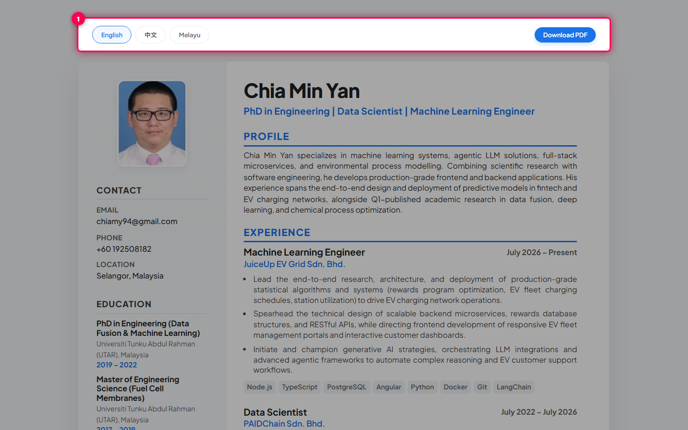

📱 <strong>Mobile View (390×844)</strong>

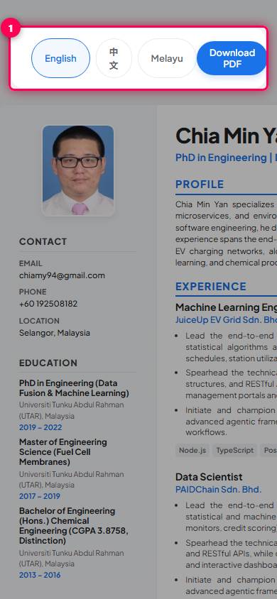

#### Step 2: Read page 1: profile, education, skills and career
- **Action**: The left column of page 1 has contact details, degrees and core skills. The right column lists professional experience, newest first.
- **Expected Result**: Page 1 shows the CV photo, 3 degrees, 12 core skills and every role, each with its dates.

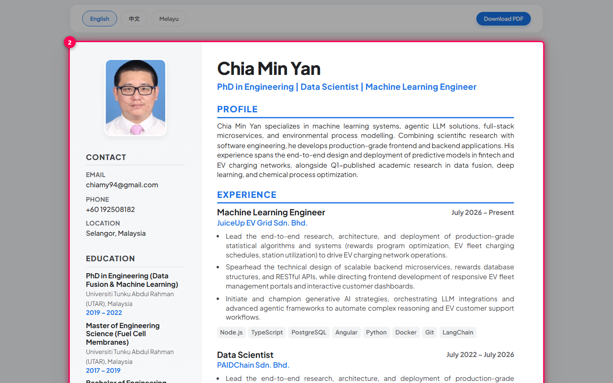

📱 <strong>Mobile View (390×844)</strong>

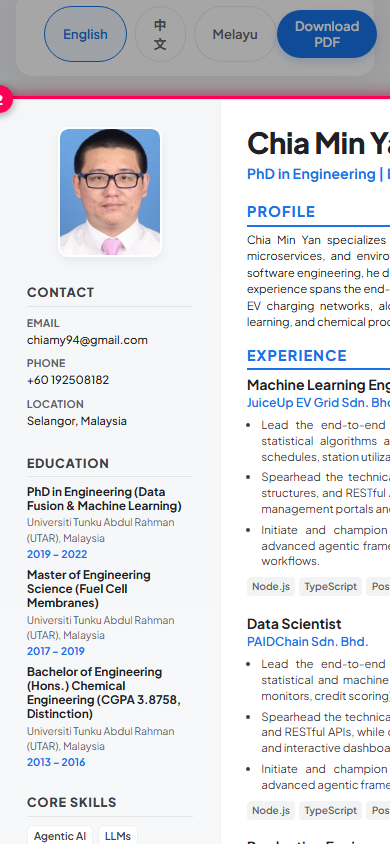

#### Step 3: Read page 2: research, publications and references
- **Action**: Scroll down to page 2 for research experience, selected publications, extracurricular activities, affiliations and references.
- **Expected Result**: Page 2 lists 5 publications with Dr. Chia's name in bold, plus 2 references.

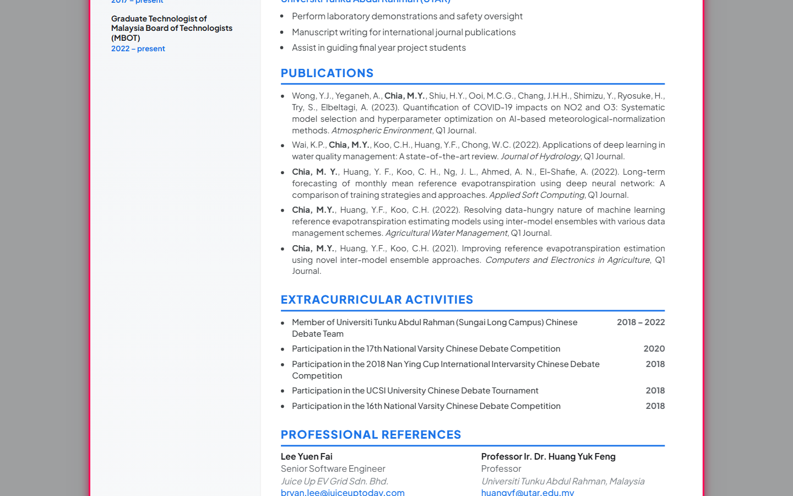

📱 <strong>Mobile View (390×844)</strong>

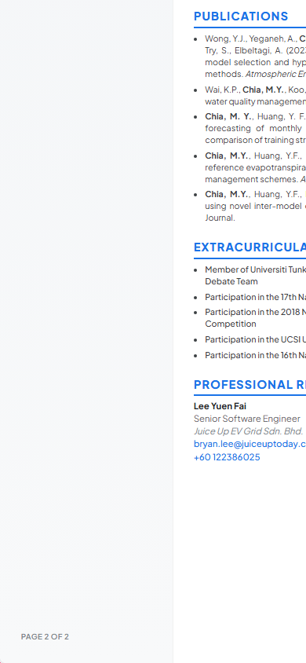

#### Step 4: Change the CV language
- **Action**: Click **中文** or **Melayu** in the top bar.
- **Expected Result**: The whole CV is translated without reloading the page, and it still fits on exactly two A4 pages.

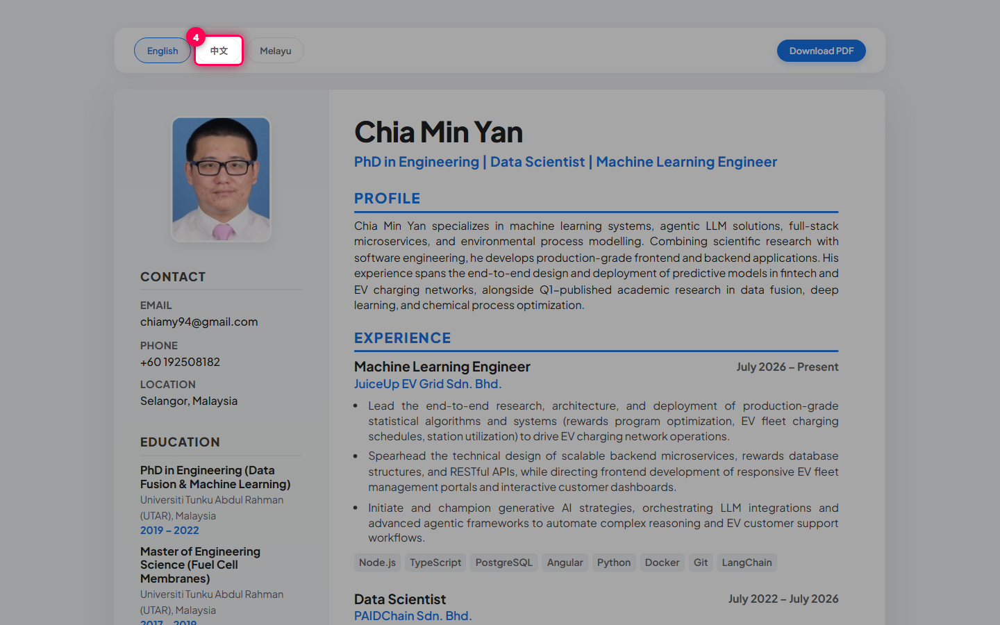

📱 <strong>Mobile View (390×844)</strong>

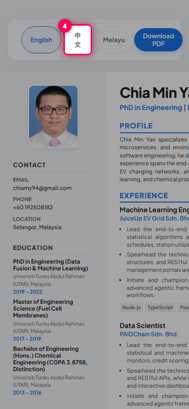

#### Step 5: Download the CV as a PDF
- **Action**: Click **Download PDF** and keep the tab open until the file has downloaded.
- **Expected Result**: The button changes to **Generating PDF...** for a few seconds, `CV_Chia_Min_Yan.pdf` is downloaded, and the button goes back to **Download PDF** so you can download again.
- **Tip**: The PDF is generated in your browser at high resolution, so it can take a few seconds on slower devices.

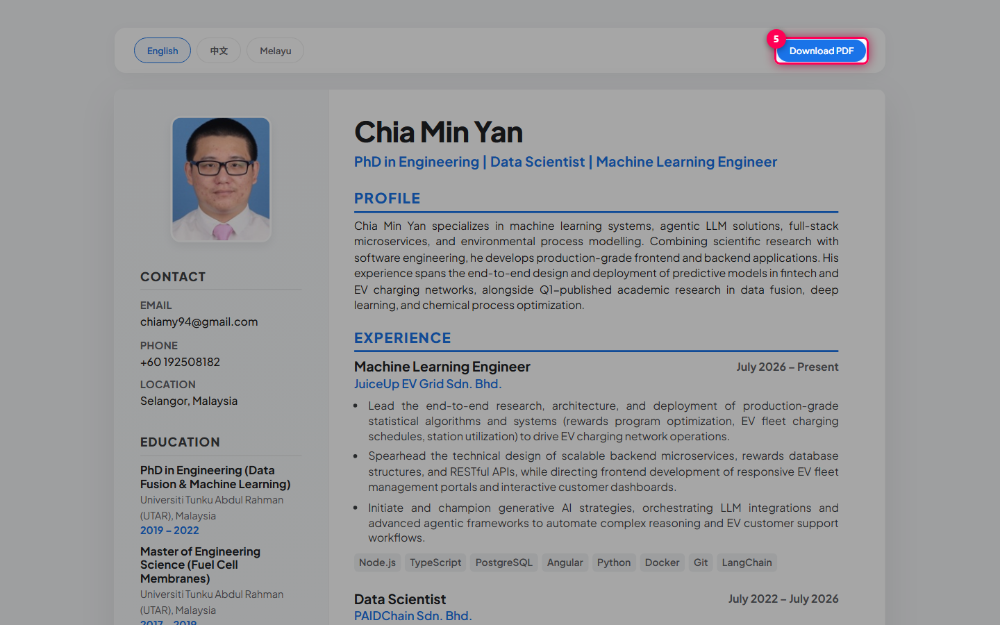

📱 <strong>Mobile View (390×844)</strong>

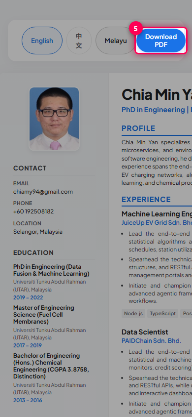

### Troubleshooting & Common Messages

| Scenario | Message Displayed | How to Resolve |
| :--- | :--- | :--- |
| The Download PDF button says "Generating PDF..." ([screenshot](../../../manual-artifacts/en-US/user/manual-cv/screenshots/trouble-01.png)) | `Generating PDF...` | The PDF is being built in your browser. This usually takes 2–3 seconds. Stay on the tab; the button comes back once the download starts. |
| Printing with Ctrl/Cmd + P adds headers or a third page | `The print preview shows browser headers or spills onto a 3rd page.` | Use **Download PDF** instead: it always gives a clean two-page A4 PDF. If you do print, turn off "Headers and footers" and set the margins to "Default". |
| The CV opened in a different language from the portfolio | `The language in the CV does not match the portfolio.` | Open the CV with **Download CV** on the portfolio: the link carries your current language (`?lang=`). You can also pick a language in the CV's top bar. |

---

## Exploring the Portfolio

> **Role**: `user` | **Language**: `en-US` | **Route**: `/`

Find your way around Dr. Chia Min Yan's portfolio: switch the interface language, jump between sections, browse expertise and career history, and open the printable CV.

### Prerequisites
- You are using an up-to-date browser (Chrome, Edge, Firefox or Safari).
- You are online, so the page can load its language files.

### Step-by-Step Guide

#### Step 1: Read the profile introduction
- **Action**: Start at the top of the page. The introduction summarises the profile and has two shortcut buttons: **Contact** and **Publications**.
- **Expected Result**: The name, a short bio and the two shortcut buttons are visible.

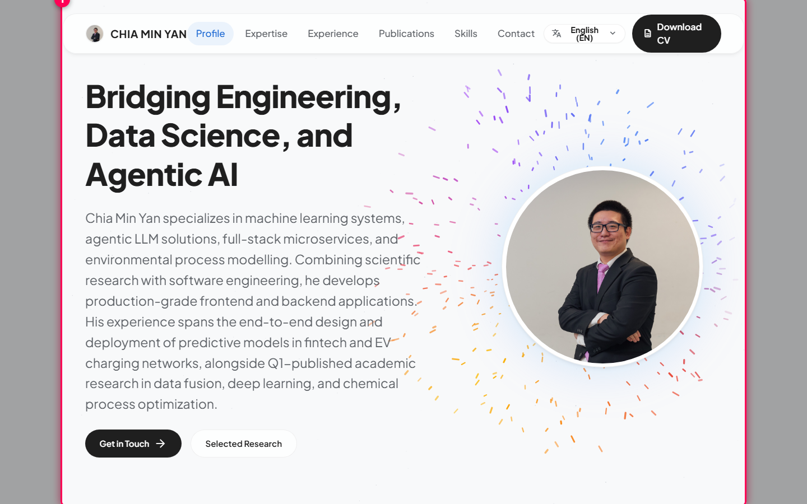

📱 <strong>Mobile View (390×844)</strong>

#### Step 2: Change the display language
- **Action**: Click the **language** button (the translate icon) in the header, then pick **English**, **中文** or **Melayu**.
- **Expected Result**: The page is translated straight away, with no reload, and the header shows the language you picked. Your choice is remembered for your next visit.
- **Tip**: The printable CV opens in whichever language is active when you open it.

📱 <strong>Mobile View (390×844)</strong>

#### Step 3: Jump to a section
- **Action**: Use the links in the header (**Profile**, **Expertise**, **Experience**, **Publications**, **Skills**, **Contact**) to scroll to that part of the page.
- **Expected Result**: The page scrolls to the section you clicked.

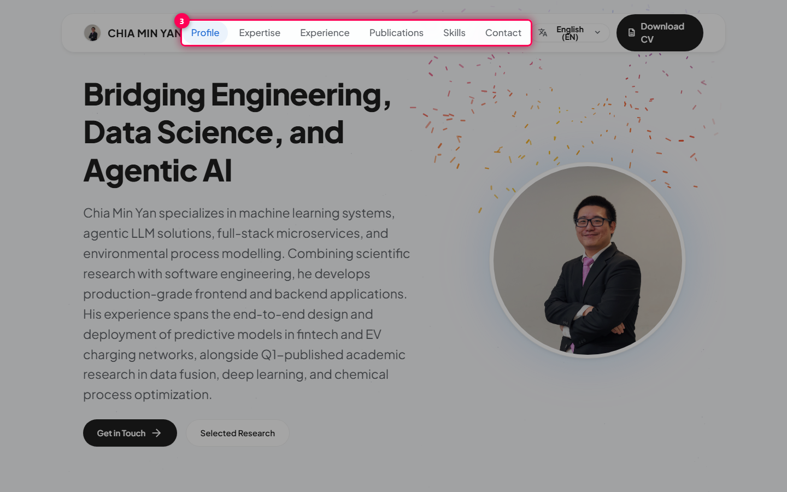

📱 <strong>Mobile View (390×844)</strong>

#### Step 4: Browse areas of expertise
- **Action**: In **Expertise**, click a topic on the left (for example **Academic Research**) to see its accomplishments and tech stack.
- **Expected Result**: The topic you clicked is highlighted, and the panel on the right shows its **Key Accomplishments** and **Technology Stack**.

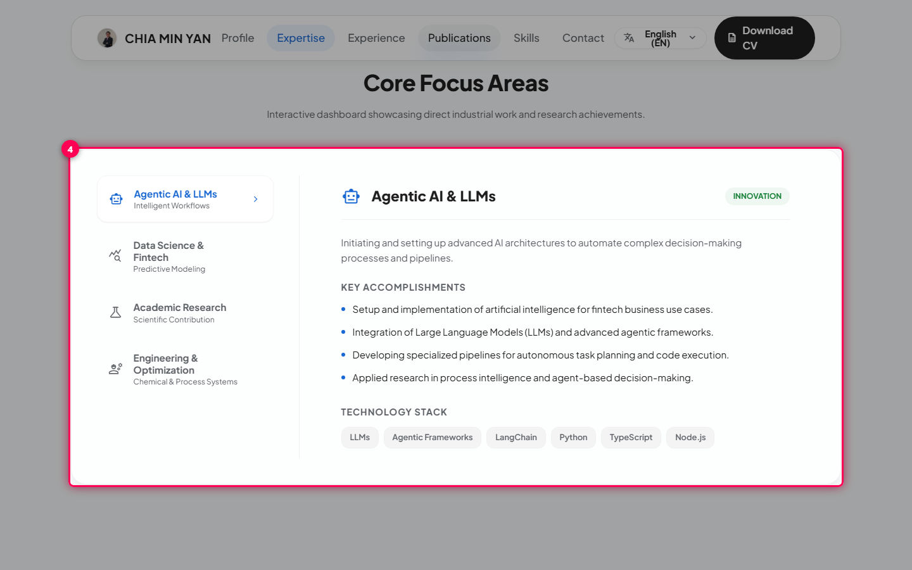

📱 <strong>Mobile View (390×844)</strong>

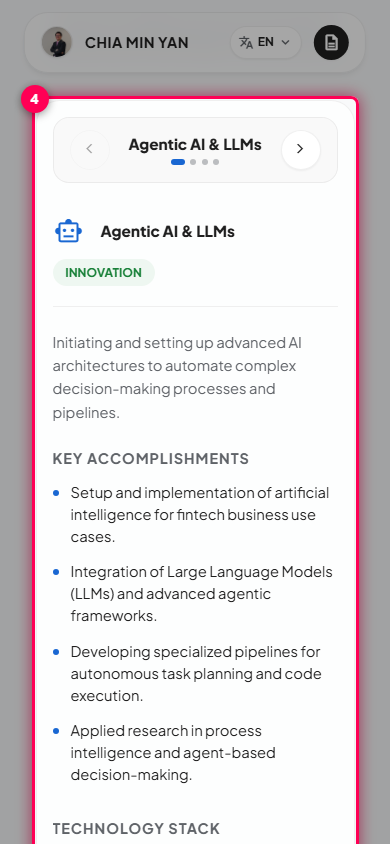

#### Step 5: Expand a role in the career timeline
- **Action**: In **Experience**, click a role (or select it with **Tab** and press **Enter** or **Space**) to show its achievements and technologies.
- **Expected Result**: The card opens to show the achievements and technology tags. Click it again to close it. The most recent role is open by default.

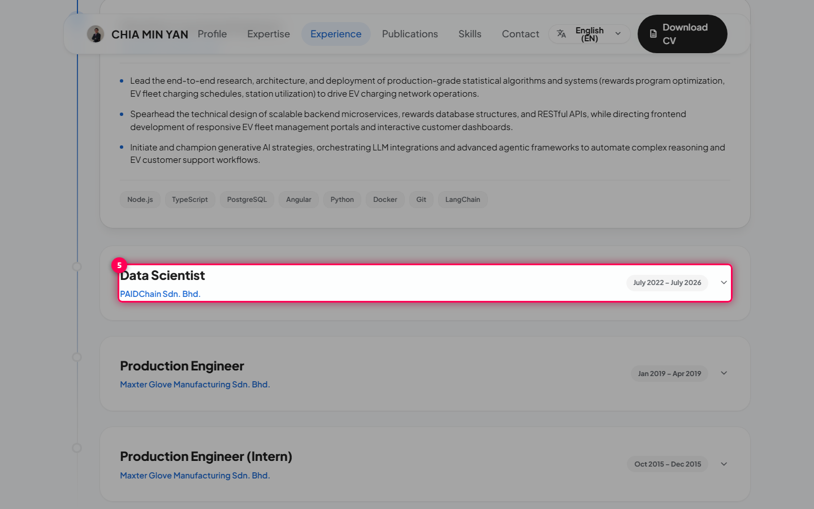

📱 <strong>Mobile View (390×844)</strong>

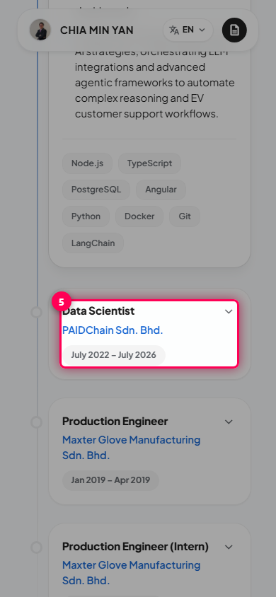

#### Step 6: Browse peer-reviewed publications
- **Action**: Scroll to **Publications** to see the selected journal papers, with their tier, year, authors and journal.
- **Expected Result**: Each card lists the full author list, with Dr. Chia's name in **bold**.

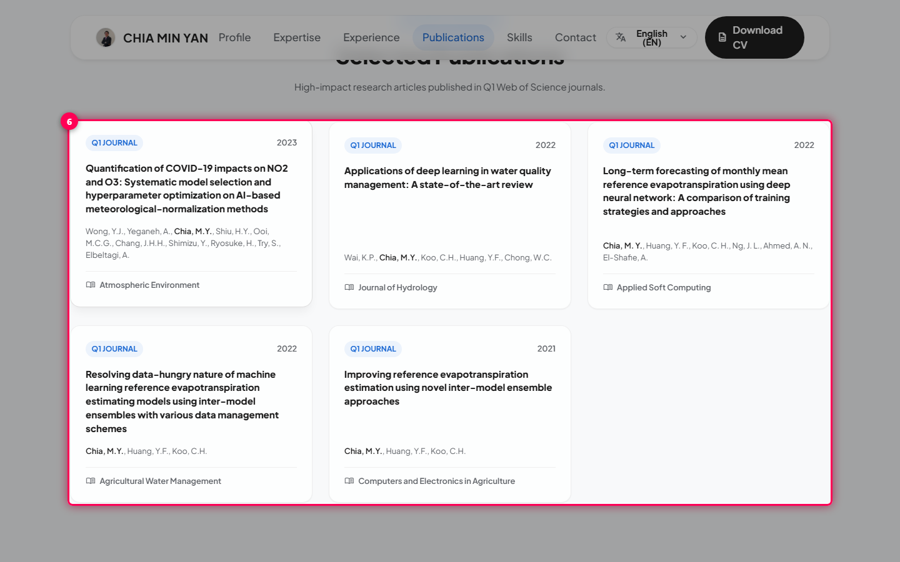

📱 <strong>Mobile View (390×844)</strong>

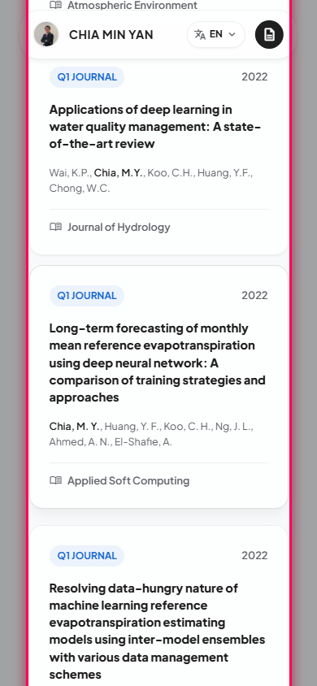

#### Step 7: Get in touch
- **Action**: In **Contact**, click the email address or phone number to open your mail or phone app. Professional references are listed alongside.
- **Expected Result**: Your email app (or dialler) opens with the address already filled in.

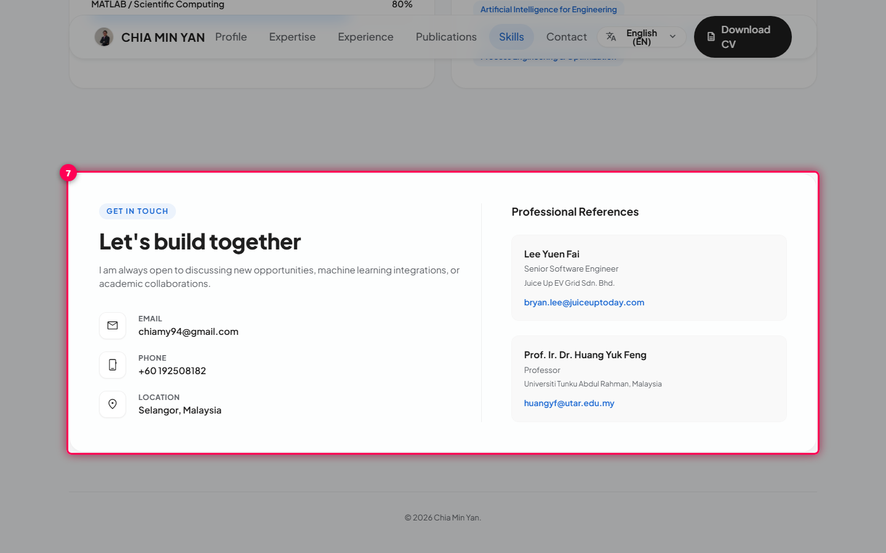

📱 <strong>Mobile View (390×844)</strong>

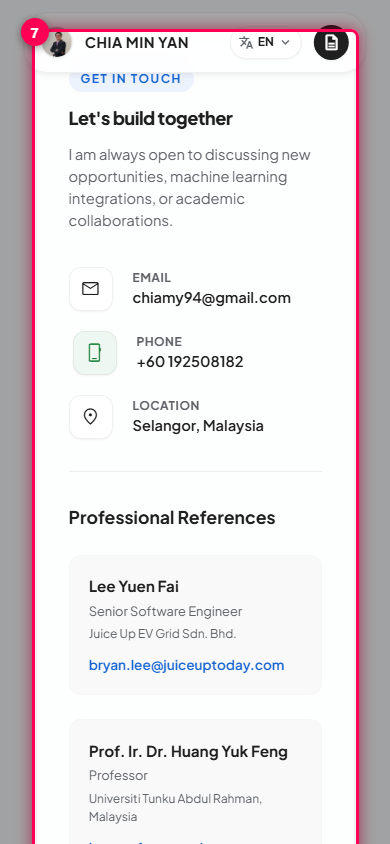

#### Step 8: Open the printable CV
- **Action**: Click **Download CV** in the header.
- **Expected Result**: The two-page A4 CV opens in a new tab, in the language you are currently using, ready to download as a PDF.

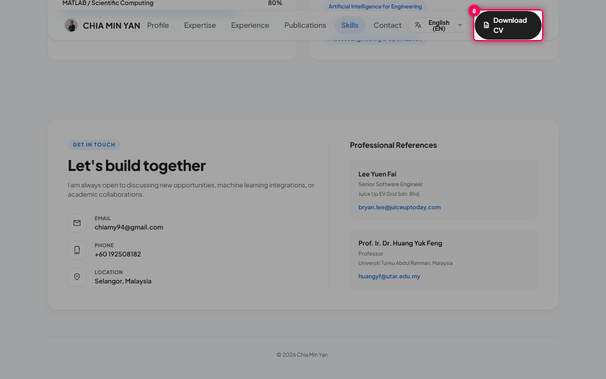

📱 <strong>Mobile View (390×844)</strong>

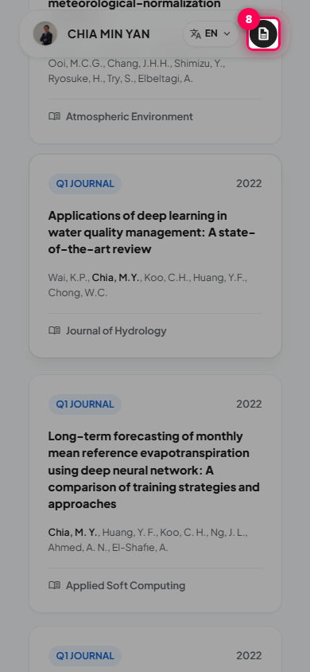

### Troubleshooting & Common Messages

| Scenario | Message Displayed | How to Resolve |
| :--- | :--- | :--- |
| The language does not change when I pick 中文 or Melayu | `The page stays in the current language and the header label does not change.` | The language file could not be downloaded (for example, you went offline). The page keeps working in the current language. Check your connection, reload the page and pick the language again. |
| I cannot see the topic list in Expertise on my phone ([screenshot](../../../manual-artifacts/en-US/user/manual-home/screenshots/trouble-01.png)) | `On narrow screens the left-hand topic list is replaced by a carousel.` | Use the **‹ / ›** arrows or tap one of the dots under the topic name to move between topics. |

